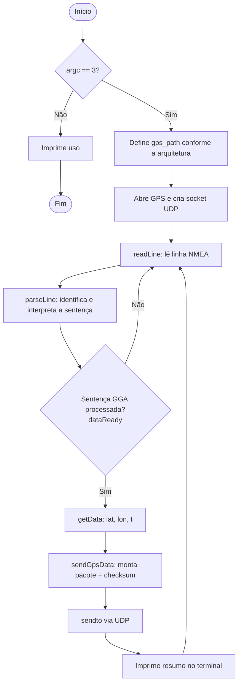
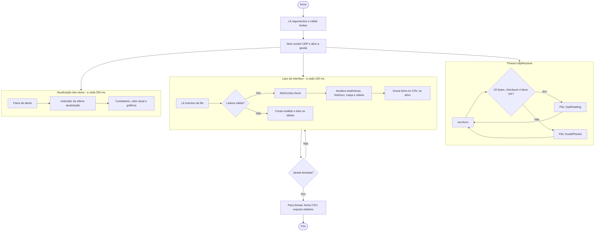
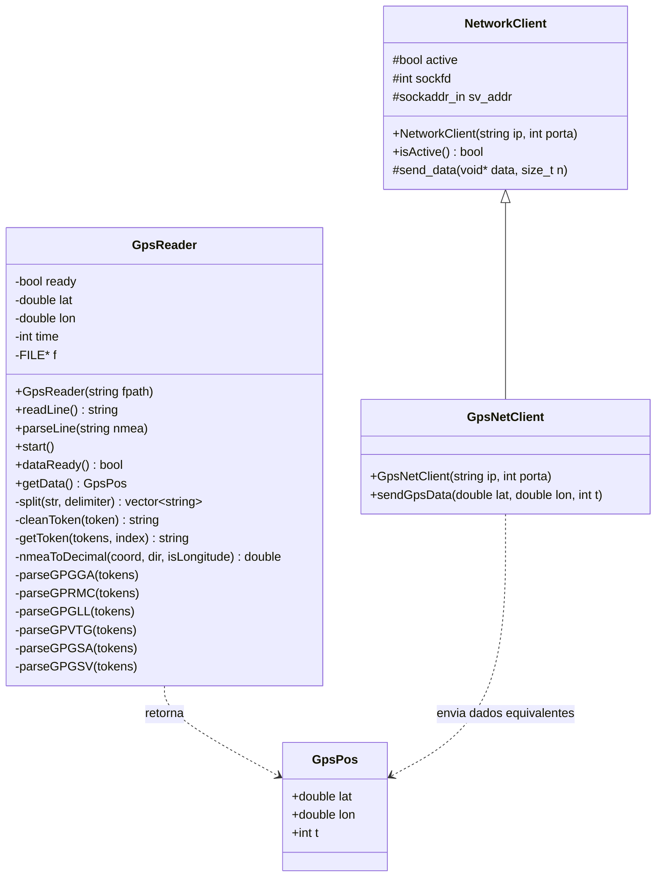
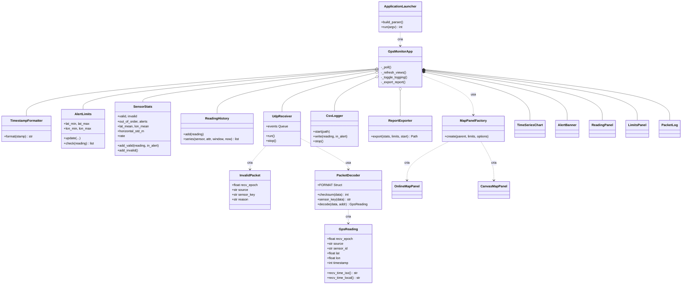
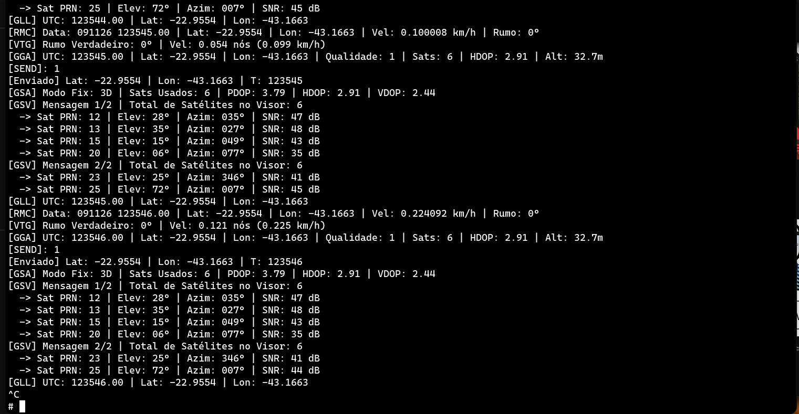
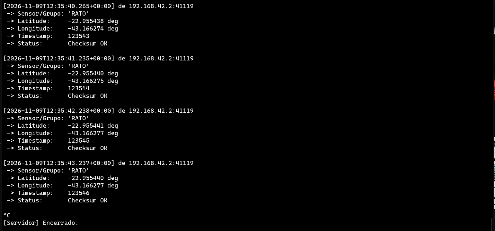
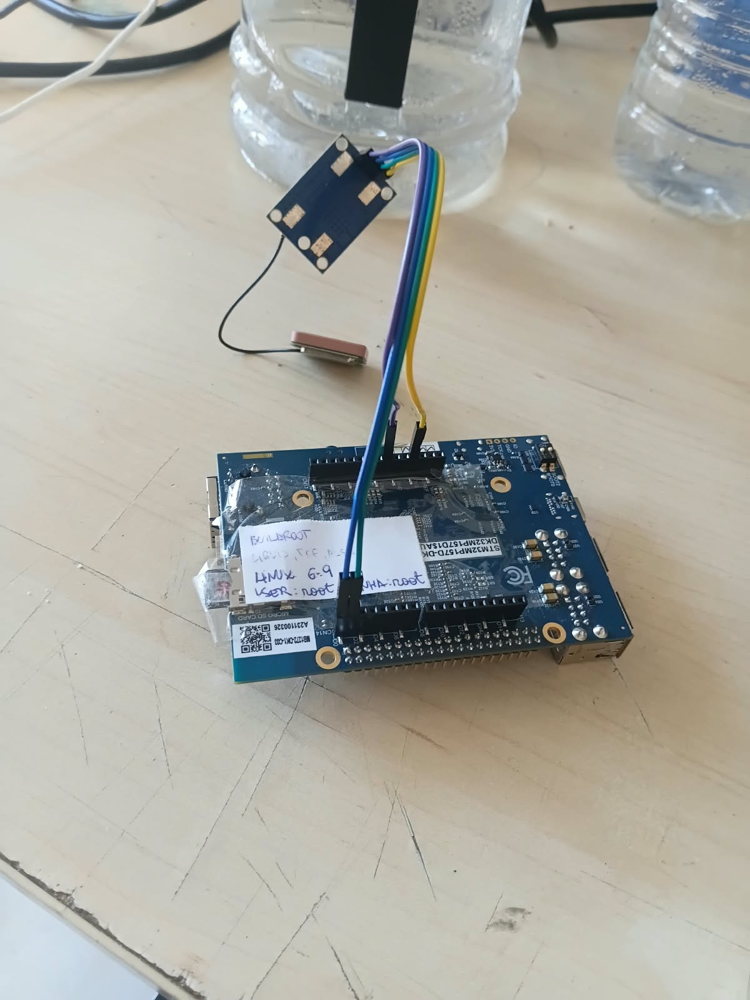

# PAEE

Sistema de monitoramento de posição GPS composto por duas partes:

- **Cliente (C++, no kit embarcado):** lê sentenças NMEA/GNSS de um receptor GPS (porta serial em tempo real ou arquivo de log), extrai a posição e a envia por UDP em um pacote binário de formato fixo.
- **Servidor/monitor (Python + Tkinter, no computador):** recebe os pacotes, valida, exibe o valor atual, o histórico gráfico e o mapa, dispara alertas visuais, grava CSV e gera relatórios.

### Grupo
- Alves
- Pedro Augusto
- Mariano
- Renato Félix

## Sumário

1. [Descrição geral](#descrição-geral)
2. [Dependências](#dependências)
3. [Compilação e uso](#compilação-e-uso)
4. [Estrutura do código](#estrutura-do-código)
5. [Fluxogramas](#fluxogramas)
6. [Diagramas de classes](#diagramas-de-classes)
7. [Protocolo de comunicação](#protocolo-de-comunicação)
8. [Descrição do sensor e funcionamento](#descrição-do-sensor-e-funcionamento)
9. [Interface e evidências](#interface-e-evidências)
10. [Análise dos valores medidos](#análise-dos-valores-medidos)
11. [Documentação do código](#documentação-do-código)

## Descrição geral

```
┌──────────────┐  NMEA 9600 8N1  ┌────────────────────────┐   UDP, 20 B    ┌─────────────────────────┐
│ Receptor GPS │ ───────────────▶│ Kit embarcado (C++)    │ ──────────────▶│ Computador (Python/Tk)  │
└──────────────┘                 │ build/GpsSensor ip porta│                │ server.py               │
                                 └────────────────────────┘                └─────────────────────────┘
```

### Cliente (kit)

O programa roda no kit embarcado e executa, em loop:

1. lê uma linha NMEA do receptor GPS;
2. interpreta a sentença (`$GPGGA`, `$GPRMC`, `$GPGLL`, `$GPVTG`, `$GPGSA`, `$GPGSV` e variantes `$GN...`);
3. a cada sentença GGA processada, converte a posição para graus decimais e a envia por UDP ao computador.

**Recursos**

- **Parsing NMEA/GNSS** das sentenças listadas acima. Apenas a GGA alimenta o envio; as demais são interpretadas e exibidas no terminal.
- **Dois modos de entrada, escolhidos na compilação:**
  - **ARM / AArch64** (kit): lê a serial `/dev/ttySTM2`, configurada pelo programa em 9600 baud, 8N1.
  - **Demais plataformas** (ex.: x86_64): lê o arquivo de log `./gps_log.txt`, útil para testar sem hardware.
- **Conversão de coordenadas** de graus/minutos (NMEA) para graus decimais.
- **Transmissão UDP** da posição em pacote binário de 20 bytes com cabeçalho e checksum.

### Servidor / monitor

Aplicação desktop (`server.py`) que escuta uma porta UDP e oferece:

- **Valor atual do sensor** (latitude, longitude, timestamp do sensor e hora de recepção);
- **Histórico gráfico** de latitude e longitude, com janela de **30 s ou 60 s** selecionável;
- **Alerta visual** quando a posição sai do retângulo de limites (faixa vermelha no topo, marcador vermelho no mapa, linhas de limite nos gráficos e linha destacada na tabela de pacotes);
- **Gravação em CSV** em tempo real (botão na interface ou `--log`);
- **Mapa** da última localização (OpenStreetMap, com *fallback* offline caso a biblioteca ou a internet não estejam disponíveis), com o **retângulo dos limites de alerta desenhado em vermelho** e atualizado quando os limites mudam;
- **Limites de alerta configuráveis em tempo de execução**;
- **Exportação automática de relatórios** (ao fechar e/ou a cada N segundos), com estatísticas e dispersão em metros;
- **Registro de timestamp** (do sensor e da recepção) e **indicador da última atualização**, que muda de cor se o sensor para de enviar;
- **Descarte e contagem de pacotes inválidos** (tamanho, checksum, faixa de coordenadas), listados na tabela;
- **Pacote *keep-alive* (0, 0, 0):** ignorado como posição (não entra no mapa, histórico, CSV nem alertas) e usado apenas para indicar que o cliente está vivo (indicador "Cliente" e contador "Keep-alive").

## Dependências

### Cliente (kit)

| Item | Detalhe |
|------|---------|
| Sistema | Linux (usa `arpa/inet.h`, `sys/socket.h`, `termios.h`) |
| Compilador | `g++` com suporte a C++20 (o código usa inicializadores designados) |
| Build | `make` |
| Documentação | `doxygen` e `graphviz` (opcional, para os grafos) |
| Hardware (kit) | Receptor GPS com saída NMEA 0183 a 9600 baud ligado à UART `/dev/ttySTM2` |

### Servidor (computador)

| Item | Detalhe |
|------|---------|
| Python | 3.9 ou superior |
| Tkinter | Já vem com o Python no Windows/macOS. No Linux: `sudo apt install python3-tk` |
| `tkintermapview` | **Opcional** (mapa online). Sem ela, o programa usa o mapa offline |
| `requests` | **Opcional** (diagnóstico do servidor de tiles; instalada junto com `tkintermapview`) |
| Rede | A porta UDP escolhida deve estar liberada no firewall do computador; kit e computador na mesma rede |

Instalação das bibliotecas opcionais:

```bash
pip install tkintermapview requests
```

## Compilação e uso

### 1. Cliente (no kit)

Compilar:

```bash
make
```

Limpar os arquivos de build:

```bash
make clean
```

Gerar a documentação Doxygen (HTML/LaTeX):

```bash
make docs
```

Executar (o programa exige o IP do computador servidor e a porta UDP):

```bash
build/GpsSensor <ip> <porta>
# exemplo
build/GpsSensor 192.168.0.10 8080
```

### 2. Servidor (no computador)

Descobrir o IP do computador (para passar ao cliente): `ip addr` (Linux), `ipconfig` (Windows) ou `ifconfig` (macOS).

Executar com os valores padrão (porta 8080, escuta em todas as interfaces):

```bash
python3 server.py
```

Exemplo com opções:

```bash
python3 server.py -p 5000 -l gps_log.csv --report-interval 60 \
    --lat-min -23.10 --lat-max -22.70 --lon-min -43.80 --lon-max -43.10
```

| Opção | Padrão | Descrição |
|-------|--------|-----------|
| `-p`, `--port` | `8080` | Porta UDP de escuta |
| `--host` | `0.0.0.0` | Endereço de escuta |
| `-l`, `--log ARQUIVO.csv` | — | Já inicia gravando o CSV neste arquivo (também é possível iniciar pelo botão) |
| `--time-unit` | `hhmmss` | Formato do timestamp do cliente: `hhmmss` (hora UTC, usado pelo nosso cliente), `s`/`ms` (epoch) ou `raw` |
| `--lat-min`, `--lat-max` | `-23.10`, `-22.70` | Limites iniciais de latitude (alteráveis na interface) |
| `--lon-min`, `--lon-max` | `-43.80`, `-43.10` | Limites iniciais de longitude (alteráveis na interface) |
| `--report-dir` | `relatorios` | Pasta dos relatórios |
| `--report-interval SEG` | `0` | Exporta relatório a cada SEG segundos (0 = só ao fechar) |
| `--tile-server URL` | OpenStreetMap | Servidor de tiles alternativo |
| `--map-cache ARQUIVO.db` | — | Banco SQLite de tiles pré-baixado (uso offline) |

### 3. Teste completo sem hardware (um só computador)

Em um terminal, inicie o servidor:

```bash
python3 server.py -p 5000
```

Em outro, compile e execute o cliente em x86_64 (lê `./gps_log.txt`):

```bash
make
build/GpsSensor 127.0.0.1 5000
```

### 4. Execução no kit, com GPS real

1. Inicie o servidor no computador e anote o IP.
2. No kit, execute `build/GpsSensor <ip-do-computador> <porta>`.
3. Ao ouvir os primeiros pacotes, a interface muda de "Aguardando dados do sensor…" para "Dentro dos limites" (ou alerta).

### Uso da interface

| Ação | Como |
|------|------|
| Ver valor atual | Painel "Valor atual do sensor" |
| Trocar janela do histórico | Botões "30 s" / "60 s" em "Visualização" |
| Escolher o sensor/grupo exibido | Caixa "Sensor" (identificado pelo header do pacote) |
| Alterar limites de alerta | Painel "Limites de alerta" → editar valores → "Aplicar limites" (o retângulo vermelho no mapa acompanha) |
| Ver os limites no mapa | Botão "Enquadrar limites de alerta" (mapa online) |
| Saber se o cliente está vivo | Rótulo "Cliente: ativo / SEM SINAL" no canto superior direito |
| Gravar CSV | "Iniciar gravação CSV…" (escolhe o arquivo; formato abaixo) |
| Exportar relatório | "Exportar relatório" ou caixa "Exportar relatório ao fechar" |

Formato do CSV (`recv_time` em UTC; `alert` = 1 se fora dos limites):

```
recv_time,source,sensor_id,lat,lon,unit,timestamp,alert
2026-11-15T14:35:19.123+00:00,192.168.0.20:51234,RATO,-22.9068000,-43.1729000,deg,123519,0
```

### Receptor mínimo em Python (exemplo didático)

O servidor completo está em `server.py`. Para só decodificar o pacote no terminal:

```python
import socket, struct

sock = socket.socket(socket.AF_INET, socket.SOCK_DGRAM)
sock.bind(("0.0.0.0", 5000))

while True:
    data, addr = sock.recvfrom(64)
    if len(data) != 20:
        continue
    header, lat, lon, t, chksum = struct.unpack("<4siiiI", data)
    if header != b"RATO" or sum(data[:16]) != chksum:
        continue  # pacote inválido
    print(f"lat={lat / 1e7:.7f} lon={lon / 1e7:.7f} t={t}")
```

## Estrutura do código

```
.
├── main.cpp         # cliente: integra leitura GPS e envio UDP
├── gps.h            # GpsPos e GpsReader (interface)
├── GpsReader.cpp    # leitura serial/arquivo e parsing NMEA
├── network.h        # NetworkClient e GpsNetClient (interface)
├── network.cpp      # socket UDP e montagem do pacote
├── server.py        # servidor/monitor com interface Tkinter
├── Makefile
├── Doxyfile
├── relatorios/      # relatórios gerados pelo servidor (criada automaticamente)
└── docs/img/        # capturas de tela, fotos e demais evidências
```

### Cliente (C++)

#### `GpsPos` (struct)

Posição simplificada devolvida por `GpsReader::getData()`: `lat` e `lon` em graus decimais (negativos ao Sul e a Oeste) e `t`, a hora UTC no formato `hhmmss` (parte inteira).

#### `GpsReader`

Lê sentenças NMEA de um arquivo ou serial e faz o parsing.

| Método | Função |
|--------|--------|
| `GpsReader(fpath)` | Abre o arquivo/dispositivo; em ARM/AArch64 configura a serial (9600, 8N1). |
| `readLine()` | Lê uma linha (até 99 caracteres), sem o `\n`. |
| `parseLine(nmea)` | Separa os campos e chama o parser da sentença correspondente. |
| `start()` | Loop bloqueante de leitura/parsing até EOF (não usado em `main.cpp`). |
| `dataReady()` | `true` se há uma posição GGA nova ainda não consumida. |
| `getData()` | Devolve a posição e zera a flag de prontidão. |
| `parseGPGGA/GPRMC/GPGLL/GPVTG/GPGSA/GPGSV` | Parsers privados; só a GGA atualiza `getData()`. |
| `nmeaToDecimal`, `split`, `cleanToken`, `getToken` | Auxiliares privados de conversão e tokenização. |

#### `NetworkClient`

Cliente UDP/IPv4 genérico. Cria o socket no construtor e o fecha no destrutor.

| Membro | Função |
|--------|--------|
| `NetworkClient(ip, porta)` | Configura o endereço do servidor e cria o socket `SOCK_DGRAM`. |
| `isActive()` | `true` se o socket está válido e nenhum envio falhou. |
| `send_data(data, n)` (protegido) | Envia `n` bytes com `sendto`; marca o cliente como inativo se falhar. |

#### `GpsNetClient` (herda de `NetworkClient`)

| Método | Função |
|--------|--------|
| `sendGpsData(lat, lon, t)` | Monta o pacote de 20 bytes (ver protocolo), calcula o checksum e envia. |

### Servidor (Python)

O código segue programação orientada a objetos, sem variáveis globais. Cada classe tem uma responsabilidade.

#### Domínio / protocolo

| Classe | Função |
|--------|--------|
| `GpsReading` | Dado imutável de uma leitura válida (hora de recepção, origem, id do sensor, lat, lon, timestamp). Propriedades `recv_time_iso` e `recv_time_local`. |
| `InvalidPacket` | Dado imutável de um pacote descartado, com o motivo. |
| `PacketError` | Exceção levantada na validação. |
| `Heartbeat` | Dado imutável de um pacote 0,0,0 (cliente vivo, sem posição). |
| `PacketDecoder` | `decode(data, addr)` valida tamanho, checksum e faixa e devolve `GpsReading` (posição) ou `Heartbeat` (0,0,0); `checksum(data)`; `sensor_key(data)`. |
| `TimestampFormatter` | `format(stamp)` apresenta o timestamp do sensor conforme `--time-unit` (`hhmmss`, `s`, `ms`, `raw`). |
| `AlertLimits` | Retângulo de alerta. `update(...)` valida e altera em tempo real; `check(reading)` devolve a lista de violações. |
| `SensorStats` | Contadores (válidos, inválidos, keep-alive, fora de ordem, alertas), mín/máx/média, desvio padrão (algoritmo de Welford), dispersão em metros e taxa de pacotes. |
| `ReadingHistory` | Janela deslizante de 60 s por sensor; `series(sensor, atributo, janela, agora)` alimenta os gráficos. |

#### Entrada / saída

| Classe | Função |
|--------|--------|
| `UdpReceiver` | *Thread* que recebe UDP e publica `GpsReading`/`InvalidPacket` numa fila; a interface consome a fila (sem acesso concorrente a widgets Tk). |
| `CsvLogger` | `start(path)`, `write(reading, in_alert)`, `stop()`; grava em modo *append* com `flush` a cada linha. |
| `ReportExporter` | `export(stats, limits, session_start)` gera `relatorio_gps_AAAAMMDD_HHMMSS.txt`. |

#### Interface (Tkinter)

| Classe | Função |
|--------|--------|
| `OnlineMapPanel` | Mapa com tiles do OpenStreetMap (`tkintermapview`), retângulo dos limites de alerta (`refresh_limits`) e diagnóstico da conexão (`TileProbe`). |
| `CanvasMapPanel` | Mapa offline simples: trilha, marcador e retângulo de limites (visível mesmo antes da primeira posição). |
| `MapPanelFactory` | Escolhe o mapa online se a biblioteca existir; senão, o offline. |
| `TimeSeriesChart` | Gráfico de linha (valor × tempo) com linhas dos limites. |
| `AlertBanner` | Faixa de estado: aguardando / dentro dos limites / ALERTA. |
| `ReadingPanel` | Valor atual do sensor selecionado. |
| `LimitsPanel` | Edição dos limites de alerta em tempo real, com validação. |
| `PacketLog` | Tabela dos últimos 200 pacotes (alertas e descartados destacados). |
| `GpsMonitorApp` | Janela principal: consome a fila (`_poll`), atualiza as views (`_refresh_views`), controla CSV e relatórios. |
| `ApplicationLauncher` | Lê os argumentos de linha de comando e inicia a aplicação. |

## Fluxogramas

### Cliente



### Servidor



## Diagramas de classes

### Cliente



### Servidor



## Protocolo de comunicação

Comunicação **UDP** (IPv4) unidirecional: o kit envia, o computador recebe (*fire-and-forget*; o servidor não responde). Cada datagrama tem **20 bytes**, com campos de 4 bytes em **ordem de bytes nativa do kit** (little-endian em ARM/x86), sem conversão para ordem de rede.

| Offset | Tamanho | Campo | Tipo | Descrição |
|-------:|--------:|-------|------|-----------|
| 0 | 4 | `header` | `char[4]` | ASCII `'R' 'A' 'T' 'O'` (identifica o grupo/sensor) |
| 4 | 4 | `lat` | `int32_t` | Latitude em graus × 10⁷ |
| 8 | 4 | `lon` | `int32_t` | Longitude em graus × 10⁷ |
| 12 | 4 | `t` | `int32_t` | Hora UTC `hhmmss` (ex.: 123519 = 12:35:19) |
| 16 | 4 | `chksum` | `int32_t` | Soma aritmética (byte a byte, sem sinal) dos 16 bytes anteriores |

- **Conversão:** `graus = lat / 10_000_000`. A resolução é de 10⁻⁷ grau (cerca de 1 cm).
- **Faixas válidas:** latitude entre −90 e +90; longitude entre −180 e +180.
- **Pacote *keep-alive*:** `lat = lon = t = 0` (com checksum válido) indica que o cliente está ativo, mas ainda sem posição GPS (sem *fix*). O servidor **não** o trata como localização: apenas atualiza o indicador de cliente ativo e o contador de keep-alive. A faixa superior mostra "Cliente ativo, mas sem posição GPS" até chegar uma posição real.
- **Validação no servidor:** tamanho (20 bytes), `chksum == sum(bytes[0:16])` (módulo 2³²) e faixa das coordenadas. O `header` não é rejeitado: ele identifica o grupo/sensor, de modo que o mesmo servidor atende vários grupos (cada um aparece como um sensor na caixa "Sensor"). Pacotes inválidos são descartados, contados e listados na tabela.
- **Exemplo:** latitude −22,9068 e longitude −43,1729 são enviadas como `-229068000` e `-431729000`.
- **Timestamp:** o servidor interpreta `t` como `hhmmss` por padrão (`--time-unit hhmmss`) e também registra a hora de recepção com precisão de milissegundos.

## Descrição do sensor e funcionamento
- **Interface:** serial UART, 9600 baud, 8N1, ligada a `/dev/ttySTM2` no kit.
- **Saída:** texto ASCII no padrão NMEA 0183, uma sentença por linha, no formato `$<tipo>,<campo>,...*<checksum>`.
- **Sentenças usadas:**

| Sentença | Conteúdo | Uso no projeto |
|----------|----------|----------------|
| `GGA` | Hora, posição, qualidade do fix, nº de satélites, HDOP, altitude | Gera a posição enviada por UDP |
| `RMC` | Hora, data, posição, velocidade e rumo | Exibida no terminal |
| `GLL` | Posição e hora | Exibida no terminal |
| `VTG` | Rumo e velocidade sobre o solo | Exibida no terminal |
| `GSA` | Modo de fix (2D/3D) e DOP | Exibida no terminal |
| `GSV` | Satélites visíveis (PRN, elevação, azimute, SNR) | Exibida no terminal |

- **Conversão de coordenadas:** o NMEA entrega `ddmm.mmmm` (latitude) e `dddmm.mmmm` (longitude). A conversão é `graus + minutos / 60`, com sinal negativo para `S` e `W`.

**Funcionamento:** o receptor calcula a posição a partir dos satélites visíveis e a publica na UART como sentenças NMEA. O programa do kit lê cada linha, interpreta a sentença e, a cada GGA, envia a posição ao servidor. O servidor valida o pacote, compara com os limites e atualiza a interface.

## Interface e evidências

### Capturas de tela

| Evidência | Captura |
|-----------|---------|
| Terminal do kit com o programa rodando (`[GGA]`, `[Enviado]`) |  |
| Terminal do servidor (mensagem "Escutando em … (UDP)") |  |
| Interface completa do monitor com dados chegando (valor atual, mapa, gráficos, tabela) |  |
| Janela de histórico em 30 s e em 60 s |  |
| **Alerta visual** (faixa vermelha, marcador vermelho, linha de limite no gráfico) |  |
| **Limites de alerta desenhados no mapa** (retângulo vermelho) |  |
| **Indicador de última atualização** em verde, laranja e vermelho ("SEM DADOS") |  |
| Gravação em CSV (botão ativo e arquivo aberto no editor/planilha) |  |
| Relatório exportado (`relatorios/relatorio_gps_*.txt`) |  |
| Sensor ligado ao kit |  |

### Vídeo de demonstração

<!-- Cole aqui o link do vídeo (YouTube/Drive) ou o arquivo em docs/video/ -->

**Link do vídeo:** [](docs/video/video.mp4)

> O vídeo deve mostrar: (1) o kit enviando no terminal; (2) o monitor recebendo e atualizando o valor atual e os gráficos; (3) um alerta sendo disparado ao sair dos limites; (4) a alteração dos limites em tempo real; (5) a gravação do CSV e o relatório gerado.

## Análise dos valores medidos

**Como as grandezas em metros são calculadas** (aproximação local):

```
desvio_N-S [m] = desvio_lat [°] × 111 320
desvio_L-O [m] = desvio_lon [°] × 111 320 × cos(latitude_média)
horizontal [m] = √(desvio_N-S² + desvio_L-O²)
```

### Gráficos

<!-- Gráfico do histórico de lat/lon (captura da interface) e, se desejado, gráfico gerado a partir do CSV (matplotlib/planilha) -->


## Documentação do código

- **Cliente (C++):** gerada com Doxygen a partir dos comentários dos headers (`gps.h`, `network.h`) e de `main.cpp`:

  ```bash
  make docs
  ```

  A saída HTML fica no diretório definido por `OUTPUT_DIRECTORY` no `Doxyfile`; abra o `index.html` gerado.

- **Servidor (Python):** o cabeçalho de `server.py` documenta o protocolo, a estrutura de classes e os requisitos atendidos; cada classe e método possui *docstring*. Para consultar no terminal:

  ```bash
  python3 -m pydoc server
  # ou, para gerar HTML:
  python3 -m pydoc -w server
  ```
