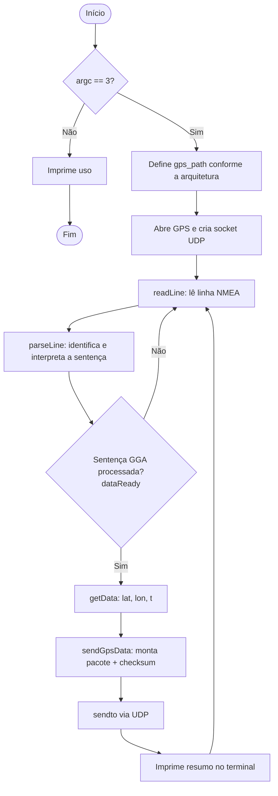
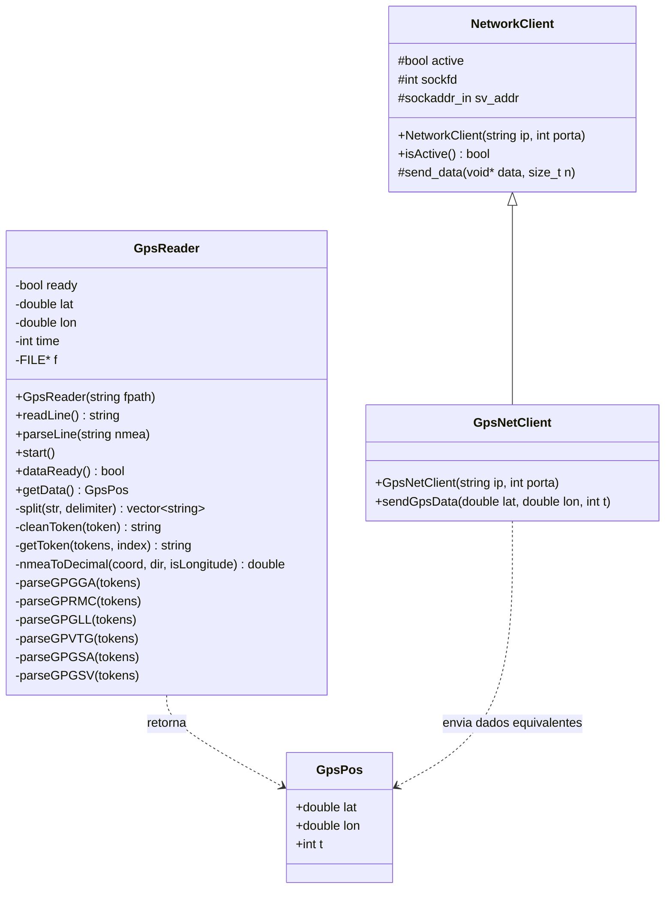
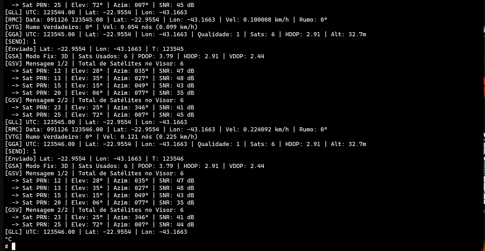
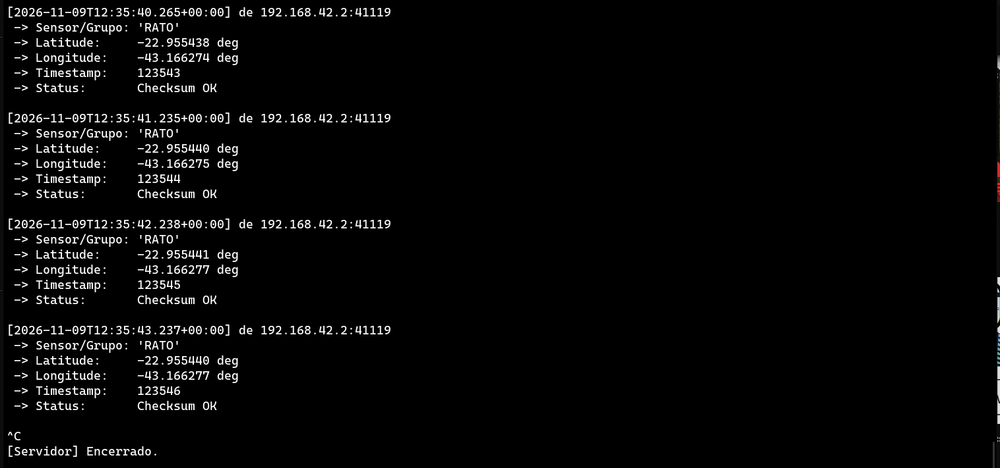
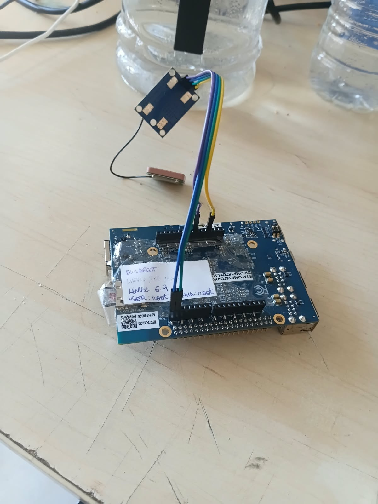

# PAEE

Sistema em C++ que lê sentenças NMEA/GNSS de um receptor GPS (porta serial em tempo real ou arquivo de log), extrai a posição e a envia por UDP a um computador servidor em um pacote binário de formato fixo.

### Grupo
- Alves
- Pedro Augusto  
- Mariano
- Renato Félix

## Sumário

1. [Descrição geral](#descrição-geral)
2. [Dependências](#dependências)
3. [Compilação e uso](#compilação-e-uso)
4. [Estrutura do código](#estrutura-do-código)
5. [Fluxograma](#fluxograma)
6. [Diagrama de classes](#diagrama-de-classes)
7. [Protocolo de comunicação](#protocolo-de-comunicação)
8. [Descrição do sensor e funcionamento](#descrição-do-sensor-e-funcionamento)
9. [Interface e evidências](#interface-e-evidências)
10. [Análise dos valores medidos](#análise-dos-valores-medidos)
11. [Documentação do código](#documentação-do-código)

## Descrição geral

O programa roda no kit embarcado e executa, em loop:

1. lê uma linha NMEA do receptor GPS;
2. interpreta a sentença (`$GPGGA`, `$GPRMC`, `$GPGLL`, `$GPVTG`, `$GPGSA`, `$GPGSV` e variantes `$GN...`);
3. a cada sentença GGA processada, converte a posição para graus decimais e a envia por UDP ao computador.

**Recursos**

- **Parsing NMEA/GNSS** das sentenças listadas acima. Apenas a GGA alimenta o envio; as demais são interpretadas e exibidas no terminal.
- **Dois modos de entrada, escolhidos na compilação:**
  - **ARM / AArch64** (kit): lê a serial `/dev/ttySTM2`, configurada pelo programa em 9600 baud, 8N1.
  - **Demais plataformas** (ex.: x86_64): lê o arquivo de log `./gps_log.txt`, útil para testar sem hardware.
- **Conversão de coordenadas** de graus/minutos (NMEA) para graus decimais.
- **Transmissão UDP** da posição em pacote binário de 20 bytes com cabeçalho e checksum.

## Dependências

| Item | Detalhe |
|------|---------|
| Sistema | Linux (usa `arpa/inet.h`, `sys/socket.h`, `termios.h`) |
| Compilador | `g++` com suporte a C++20 (o código usa inicializadores designados) |
| Build | `make` |
| Documentação | `doxygen` e `graphviz` (opcional, para os grafos) |
| Hardware (kit) | Receptor GPS com saída NMEA 0183 a 9600 baud ligado à UART `/dev/ttySTM2` |

## Compilação e uso

Compilar:

```bash
make
```

Limpar os arquivos de build:

```bash
make clean
```

Gerar a documentação Doxygen (HTML/LaTeX):

```bash
make docs
```

Executar (o programa exige o IP e a porta UDP do servidor):

```bash
build/GpsSensor <ip> <porta>
# exemplo
build/GpsSensor 192.168.0.10 5000
```

**Receptor em Python (exemplo)** para decodificar o pacote no computador:

```python
import socket, struct

sock = socket.socket(socket.AF_INET, socket.SOCK_DGRAM)
sock.bind(("0.0.0.0", 5000))

while True:
    data, addr = sock.recvfrom(64)
    if len(data) != 20:
        continue
    header, lat, lon, t, chksum = struct.unpack("<4siiii", data)
    if header != b"RATO" or sum(data[:16]) != chksum:
        continue  # pacote inválido
    print(f"lat={lat / 1e7:.7f} lon={lon / 1e7:.7f} t={t}")
```

## Estrutura do código

```
.
├── main.cpp      # ponto de entrada: integra leitura GPS e envio UDP
├── gps.h         # GpsPos e GpsReader (interface)
├── GpsReader.cpp # leitura serial/arquivo e parsing NMEA
├── network.h     # NetworkClient e GpsNetClient (interface)
├── network.cpp   # socket UDP e montagem do pacote
├── Makefile
└── Doxyfile
```

### `GpsPos` (struct)

Posição simplificada devolvida por `GpsReader::getData()`: `lat` e `lon` em graus decimais (negativos ao Sul e a Oeste) e `t`, a hora UTC no formato `hhmmss` (parte inteira).

### `GpsReader`

Lê sentenças NMEA de um arquivo ou serial e faz o parsing.

| Método | Função |
|--------|--------|
| `GpsReader(fpath)` | Abre o arquivo/dispositivo; em ARM/AArch64 configura a serial (9600, 8N1). |
| `readLine()` | Lê uma linha (até 99 caracteres), sem o `\n`. |
| `parseLine(nmea)` | Separa os campos e chama o parser da sentença correspondente. |
| `start()` | Loop bloqueante de leitura/parsing até EOF (não usado em `main.cpp`). |
| `dataReady()` | `true` se há uma posição GGA nova ainda não consumida. |
| `getData()` | Devolve a posição e zera a flag de prontidão. |
| `parseGPGGA/GPRMC/GPGLL/GPVTG/GPGSA/GPGSV` | Parsers privados; só a GGA atualiza `getData()`. |
| `nmeaToDecimal`, `split`, `cleanToken`, `getToken` | Auxiliares privados de conversão e tokenização. |

### `NetworkClient`

Cliente UDP/IPv4 genérico. Cria o socket no construtor e o fecha no destrutor.

| Membro | Função |
|--------|--------|
| `NetworkClient(ip, porta)` | Configura o endereço do servidor e cria o socket `SOCK_DGRAM`. |
| `isActive()` | `true` se o socket está válido e nenhum envio falhou. |
| `send_data(data, n)` (protegido) | Envia `n` bytes com `sendto`; marca o cliente como inativo se falhar. |

### `GpsNetClient` (herda de `NetworkClient`)

| Método | Função |
|--------|--------|
| `sendGpsData(lat, lon, t)` | Monta o pacote de 20 bytes (ver protocolo), calcula o checksum e envia. |

## Fluxograma



## Diagrama de classes



## Protocolo de comunicação

Comunicação **UDP** (IPv4) unidirecional: o kit envia, o computador recebe. Cada datagrama tem **20 bytes**, com campos de 4 bytes em **ordem de bytes nativa do kit** (little-endian em ARM/x86), sem conversão para ordem de rede.

| Offset | Tamanho | Campo | Tipo | Descrição |
|-------:|--------:|-------|------|-----------|
| 0 | 4 | `header` | `char[4]` | ASCII `'R' 'A' 'T' 'O'` |
| 4 | 4 | `lat` | `int32_t` | Latitude em graus × 10⁷ |
| 8 | 4 | `lon` | `int32_t` | Longitude em graus × 10⁷ |
| 12 | 4 | `t` | `int32_t` | Hora UTC `hhmmss` (ex.: 123519 = 12:35:19) |
| 16 | 4 | `chksum` | `int32_t` | Soma aritmética (byte a byte, sem sinal) dos 16 bytes anteriores |

- **Conversão:** `graus = lat / 10_000_000`. A resolução é de 10⁻⁷ grau (cerca de 1 cm).
- **Validação no receptor:** conferir tamanho (20 bytes), `header == "RATO"` e `sum(bytes[0:16]) == chksum`.
- **Exemplo:** latitude −22,9068 e longitude −43,1729 são enviadas como `-229068000` e `-431729000`.

## Descrição do sensor e funcionamento

> **Preencher:** modelo do módulo GPS, tensão de operação, taxa de atualização, precisão nominal e foto da montagem.

- **Interface:** serial UART, 9600 baud, 8N1, ligada a `/dev/ttySTM2` no kit.
- **Saída:** texto ASCII no padrão NMEA 0183, uma sentença por linha, no formato `$<tipo>,<campo>,...*<checksum>`.
- **Sentenças usadas:**

| Sentença | Conteúdo | Uso no projeto |
|----------|----------|----------------|
| `GGA` | Hora, posição, qualidade do fix, nº de satélites, HDOP, altitude | Gera a posição enviada por UDP |
| `RMC` | Hora, data, posição, velocidade e rumo | Exibida no terminal |
| `GLL` | Posição e hora | Exibida no terminal |
| `VTG` | Rumo e velocidade sobre o solo | Exibida no terminal |
| `GSA` | Modo de fix (2D/3D) e DOP | Exibida no terminal |
| `GSV` | Satélites visíveis (PRN, elevação, azimute, SNR) | Exibida no terminal |

- **Conversão de coordenadas:** o NMEA entrega `ddmm.mmmm` (latitude) e `dddmm.mmmm` (longitude). A conversão é `graus + minutos / 60`, com sinal negativo para `S` e `W`.

## Interface e evidências

| Evidência | Captura |
|-----------|---------|
| Terminal do kit com o programa rodando (`[GGA]`, `[Enviado]`) |  |
| Interface/receptor no computador exibindo as posições |  |
| Sensor ligado ao kit |  |

## Documentação do código

A documentação é gerada com Doxygen a partir dos comentários dos headers (`gps.h`, `network.h`) e de `main.cpp`:

```bash
make docs
```

A saída HTML fica no diretório definido por `OUTPUT_DIRECTORY` no `Doxyfile`; abra o `index.html` gerado.
